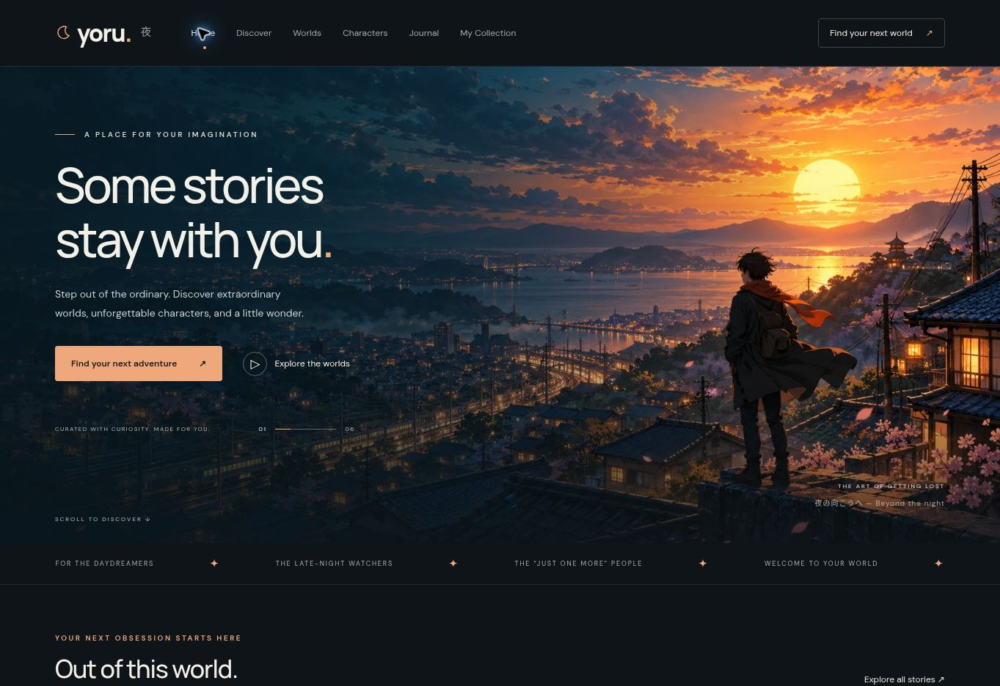

# Yoru · Beyond the ordinary

A cinematic six-page anime discovery website. Midnight blue, warm apricot, original anime artwork, and stories that stay with you.

[Open the website](https://yoru-anime-vishnu.vishnukushwaha63.chatgpt.site) · [DevOps practice roadmap](docs/devops-roadmap.md)

## Sample screenshot

Actual browser capture of the homepage:



## Six pages

| Page | What you can do |
|---|---|
| Home | Discover the featured worlds and stories |
| Discover | Search six original stories and combine genre filters |
| Worlds | Explore three settings and jump to related stories |
| Characters | Meet six original characters and open their story |
| Journal | Read three complete reflections in accessible dialogs |
| My Collection | Save and remove favourites; persists in this browser |

Responsive layouts, mobile navigation, keyboard focus styles, reduced-motion support, and native dialogs. This is an original fictional showcase, not a streaming service. Favourites are browser-local; there is no account/backend sync.

## Run

No npm installation, paid APIs, or build step required. Node 22+ and Python 3 are enough:

```bash
npm run check
npm start
# http://localhost:8080
```

Or run with Docker:

```bash
docker compose up --build -d
curl http://localhost:8080/health.json
docker compose down
```

## Ready for DevOps practice

- `Dockerfile`, `compose.yaml`, and nginx config for container deployment.
- `/health.json` on every host; `/health` additionally on nginx.
- GitHub Actions definition: validate pages/assets, build Docker, smoke-test all six pages.
- [Seven practical lab stages](docs/devops-roadmap.md): Linux/Git → Docker → CI → EC2 → CD/rollback → Kubernetes → monitoring.

Docker and the CI workflow are provided for practice; the Docker build was not run in the authoring environment. No cloud resources or AWS deployment have been configured.

## Verification

Passed locally: JavaScript syntax, six page entrypoints, local asset references, artwork presence and health JSON. Browser verified: homepage appearance, combined genre/search filtering, favourites retained across navigation, and story dialog opening/closing. Responsive CSS is included; a physical mobile-device check remains useful.

## Source layout

```text
dist/           Six HTML pages, shared CSS/JS, optimized artwork
scripts/        Dependency-free structural checks
docs/           Real browser screenshot and DevOps roadmap
.github/        CI workflow
```

## Artwork and credits

Hero and six scene panels are original AI-generated anime illustrations made for Yoru with the built-in image generation tool, optimized into `dist/assets/hero.webp` and `scenes.webp`. No franchise character assets or third-party fan models are bundled. Fonts: DM Sans and Manrope from Google Fonts; system sans-serif fallback works offline.

Artwork briefs: (1) cinematic lone rooftop traveler over a teal Japanese town at sunset, (2) six original anime scenes: ember swordswoman, neon memory courier, moon astronomer, ocean adventurer, sunset train and floating islands.
