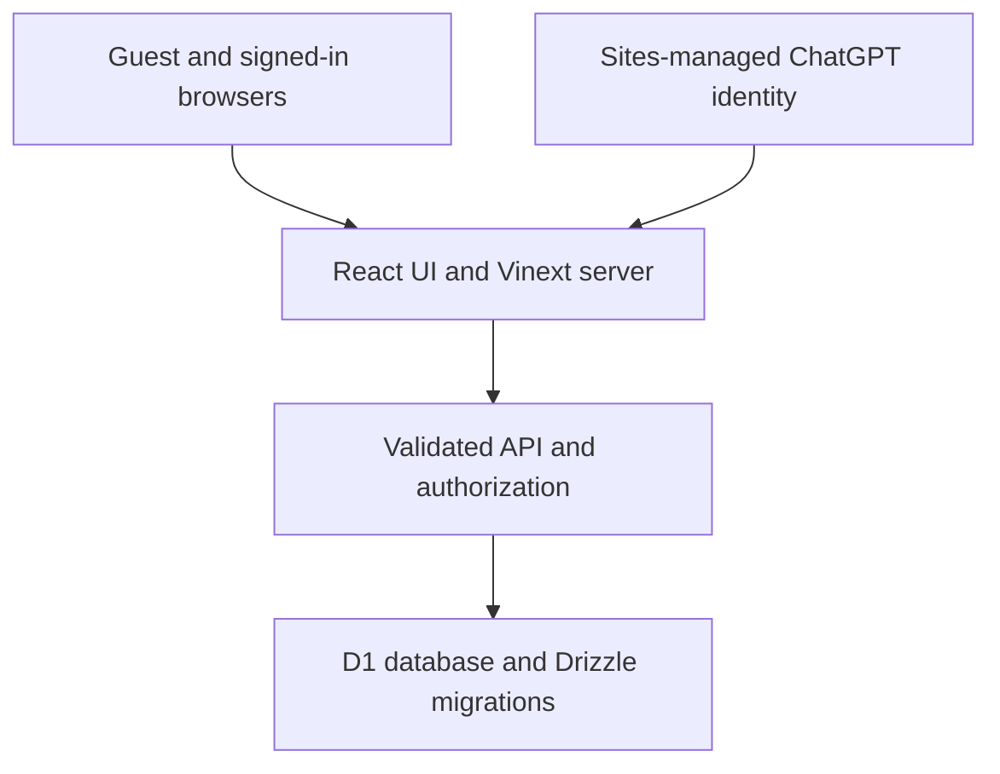

# ANIMEVERSE

**Discover your power. Meet your rival. Begin your story.**

A working anime identity experience connected to a database-backed battle discussion community. Phase 1 evolves Yoru while preserving its eleven discovery and character-creation pages.

[Open the owner-private Site](https://yoru-anime-vishnu.vishnukushwaha63.chatgpt.site) · [Implementation plan](docs/phase-1-plan.md) · [Verification report](docs/phase-1-verification.md) · [Operations](docs/operations.md)

## Actual running website

Browser capture of the implemented application, not concept art:


| Mobile layout | Personalized identity |
| --- | --- |
|  |  |

Mobile capture uses the actual site at a 390 × 844 iframe viewport, not a physical-device test.

## Phase 1 features

- Cinematic responsive home, original characters, mobile navigation, reduced motion, keyboard focus and optional synthesized ambient sound, off by default.
- Five-question guest power test: original hero archetype, power, faction, strengths, weakness, rival and story prompt. All 1,024 answer combinations are deterministic; they are not 1,024 unique illustrations.
- Reproducible `/hero/01230` URLs, generated 1200 × 630 PNG social cards and personalized 1080 × 1350 character-card downloads. Shared links contain the answer code; custom names remain in downloaded cards and saved profiles.
- Account-backed battle creation with conditions/scenarios, one final vote per account, actual totals, replies, follows, share links and search over the latest 50 discussions.
- Hosted ChatGPT sign-in integration, durable saved heroes and profiles, account-data deletion, reports, blocking and allowlisted moderation with audit history.
- Original editorial guidance, privacy/terms and optional browser-local event diagnostics. No external tracking or ad service is installed.
- Original Yoru character builder, portrait editions, saved browser creations and discovery pages preserved under `/legacy/`. Old `.html` URLs redirect there.

There are no fabricated users, votes, rankings or rewards. A new community can truthfully display an empty arena. Playable daily quests, story chapters, 3D worlds, tournaments and guilds remain later phases. The earlier unpublished cinematic-video experiment is not part of this release.

## Architecture



React 19, TypeScript, Tailwind CSS 4, Lucide, Vinext/Vite, Workers, D1/SQLite and Drizzle. Original WebP artwork and system fonts minimize external requests. The Sites starter's deployment and identity integrations are preserved.

**Architecture adaptation:** the current host uses Workers, D1 and managed sign-in. This is not a PostgreSQL/Prisma deployment or a standard Next.js Node server. The Docker/nginx configuration is an EC2-compatible **development lab**, using local Workers/D1 emulation. Independent AWS production requires a production runtime/authentication adapter and PostgreSQL migration if that database is chosen. Do not trust client-supplied identity headers outside the Sites gateway.

## Routes

| Route | Function |
| --- | --- |
| `/` | Discover and enter |
| `/power`, `/hero/[code]` | Guest power test and shared identity |
| `/arena`, `/battle/[id]` | Community discussions, voting and replies |
| `/community` | Discussion discovery and original editorial guidance |
| `/profile` | Saved hero, display name, followed discussions and blocks |
| `/settings` | Accessibility, diagnostics, sign-out and data deletion |
| `/privacy`, `/terms` | Data practices and community rules |
| `/admin` | Server-allowlisted moderators only |
| `/api/health` | Real database readiness, including 503 on failure |
| `/legacy/` | Eleven preserved Yoru experiences |

## Install and run

Use Node.js 24. Tests use built-in `node:sqlite`. No paid AI API or key is required.

```bash
npm ci
npm run build
node --import ./scripts/sites-env.mjs ./node_modules/wrangler/bin/wrangler.js d1 execute DB --local --config dist/server/wrangler.json --persist-to .wrangler/state --file drizzle/0000_tired_hobgoblin.sql
npm run dev
```

Open the URL printed by the server. Apply the initial migration **once** to a new local database; subsequently apply only new migrations. Run `npm run db:generate` when authoring schema changes. Never modify already-applied migration history. Hosted deployment applies the committed migrations separately.

Portable loopback development supports the starter's mock sign-in. Managed cloud preview intentionally disables it. Mock identity tests do not prove that live OAuth sign-in succeeded.

## Docker lab

```bash
docker compose up --build -d --wait
curl --fail http://localhost:8080/api/health
docker compose logs -f app
```

Pending local migrations apply on startup. Named `app-data` and `app-backups` volumes persist state. Nginx strips identity headers, so the lab is guest-only. Account features use hosted Sites authentication. `wrangler dev` emulates Workers/D1 here; do not expose it as a public production server. Docker was unavailable in the authoring environment; do not assume this configuration passed a Docker test.

## Environment variables

See [.env.example](.env.example). Keep `.env`, `.dev.vars`, credentials and backups out of Git.

| Name | Purpose |
| --- | --- |
| `DB` | D1 binding provisioned from `.openai/hosting.json` |
| `ADMIN_USER_IDS` | Comma-separated site-specific IDs authorized to moderate; server setting only |
| `E2E_BASE_URL` | Separately running target for Playwright tests |
| `DATA_DIRECTORY` | Local SQLite backup helper state directory |

No moderator is granted automatically. The owner must configure real site user IDs before inviting a wider community. A signed-in `/api/session` response identifies the current site-scoped ID. The app never asks for passwords or adds a second session stack.

## Tests

```bash
npm run check
npm run build
npm audit --omit=dev --audit-level=high
npm audit
npm run test:e2e
```

For the CLI browser suite, install Chromium with `npx playwright install chromium` and start the target separately. The suite contains desktop/mobile guest tests for power completion, card download, shared result, guest rejection, navigation and health. See the verification report for which tests were actually run.

GitHub Actions defines dependency install, type checking, unit/API integration tests, production-dependency audit, a separately uploaded full audit report, production build, Docker build/start, readiness, Playwright and failure logs. Full-tooling audit findings are reported rather than silently treated as a clean result. No automatic AWS deployment target or credentials are configured.

## Security and privacy

- Platform-owned identity and sessions. Every protected API action authorizes the server identity; client roles or supplied owner IDs are never trusted.
- Same-origin `Origin` checks, JSON-only writes, 8 KB payload limit, validated fields and parameterized SQL. React renders user text without raw HTML/Markdown execution.
- Database primary key enforces one vote per battle/account, including concurrent attempts. Per-account writes are throttled to 30 requests per minute per API resource. This is not complete protection against multiple accounts or coordinated abuse.
- Blocking, reports, restricted moderator actions and audit records. Configure/staff moderation before public launch.
- Production CSP, content-type protection, referrer policy and permissions policy. Framework inline scripts/styles currently require `unsafe-inline`; strict nonce-based CSP remains future hardening.
- Settings can delete app profile, saved hero and activity, including created discussions and associated replies. This does not delete a ChatGPT account or operator backups.
- Optional diagnostic events stay in the browser. No external analytics, advertising, payment processing or per-visitor AI generation.

The full dependency audit currently includes remaining build-tool advisories. See [verification](docs/phase-1-verification.md); a clean production-only npm audit is not proof that all dependencies or the application are vulnerability-free.

Artwork is original AI-generated anime-inspired artwork already produced for the project; see [art notes](docs/portrait-art.md). No unauthorized franchise images, models, clips or streams are added. Text fan commentary is independent and not official. Privacy and terms describe implementation, not legal certification.

## Status and roadmap

**Current scope: entirely 2D. 3D work is deferred and is not part of this release.**

The Phase 1 foundation is implemented and tested at the API level. Live hosted sign-in, two real-account interactions, moderator configuration and independent AWS production are still verification/operations work. The audience remains owner-private; shared links do not grant friends access. Robots and page metadata intentionally discourage indexing until public launch. Canonical URLs, sitemap, structured site metadata and dynamic hero social previews are prepared.

1. Verify live sign-in/save/vote flows with two real accounts; configure moderators, contact details, retention and backups.
2. Phase 2: guessing game, meaningful daily missions, real score-based rankings and opt-in notifications.
3. Phase 3: persistent branching stories, strategic turn-based battles, collections and one explorable district.
4. Phase 4: quality rigged 3D models, guilds and scheduled tournaments.

High-quality 3D requires actual rigged models, UV textures, coherent topology, animations and mobile LOD budgets. Existing 2D artwork is not presented as production-quality 3D. Core gameplay stays free; future cosmetics or editorial sponsors must not create paid battle advantages.

The homepage now follows the supplied Yoru portrait-studio screenshot: charcoal surfaces, warm rose accents, three selectable original portraits and a live preview. Choose a portrait to open a personalizable card, or take the five-question power test. The reference conversation URL was inaccessible; the recent uploaded screenshot supplied the visual direction.
