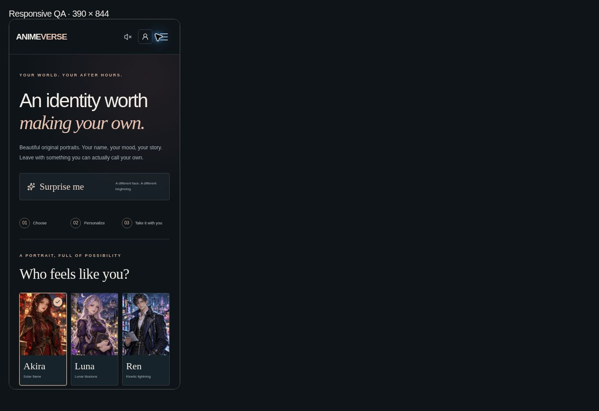
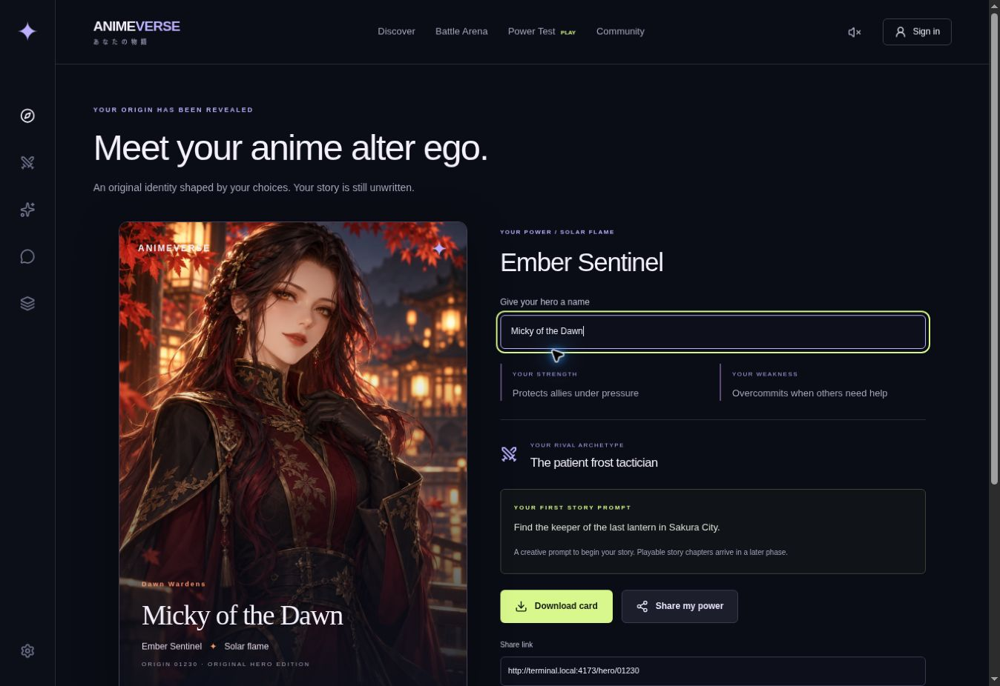
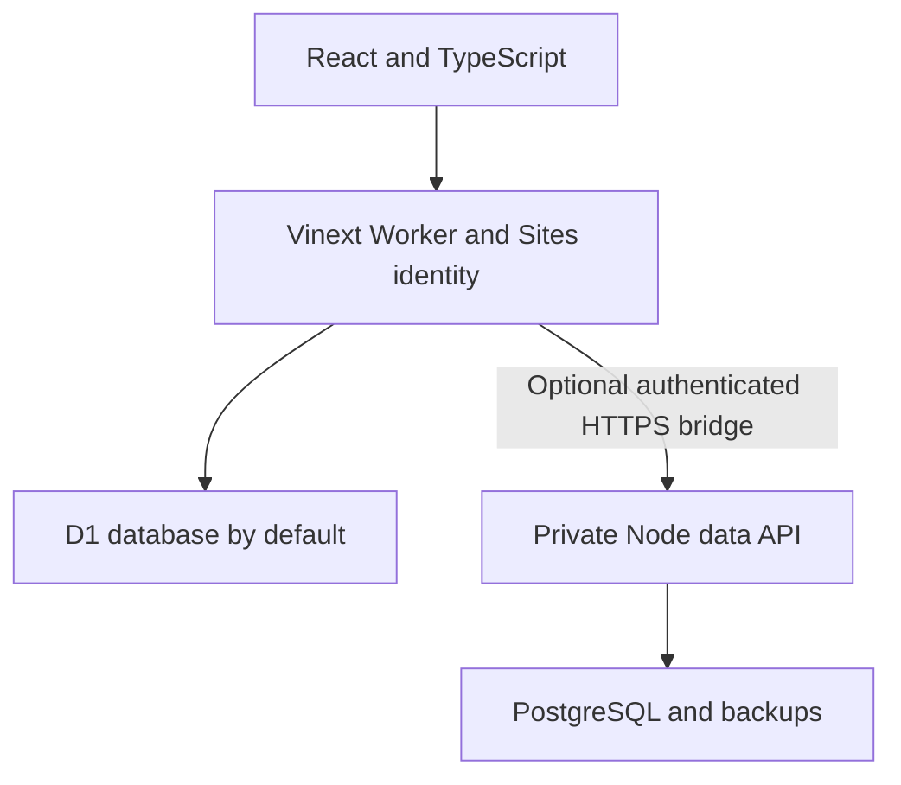

# ANIMEVERSE

**Come for a battle. Find your identity. Leave a promise in Sakura City.**

ANIMEVERSE extends the existing Yoru portrait experience into a 2D anime entertainment platform. The original homepage, power cards, discussion arena and eleven legacy pages are preserved. No 3D work is included.

[Owner-private website](https://yoru-anime-vishnu.vishnukushwaha63.chatgpt.site) · [Expansion plan](docs/expansion-plan.md) · [Implementation status](docs/expansion-status.md) · [Operations](docs/operations.md)

## Current status

The expansion is implemented in code and compiled. **Formal tests, Playwright, two-account verification, browser QA of the new pages, PostgreSQL runtime validation and a production security review are deferred.** Historical Phase 1 test results do not verify these additions. This is not a production-readiness certification.

The existing Site remains owner-private. No public launch, DNS changes, AWS provisioning, paid services or PostgreSQL data cutover are performed.

## Available experiences

| Page | Functionality implemented |
| --- | --- |
| `/` | Existing portrait-studio home, selectable original characters and power-test entry |
| `/play` | Clear entry point to games, world, social features and progression |
| `/arena`, `/battle/[id]` | Account-backed fan debates, conditions, votes, replies, follows, reports and share links |
| `/games` | Anime, character, emoji and trivia modes; 24 original text clues; five-question daily rounds, hints, timed scoring, three difficulty levels, explanations and resumable history |
| `/power`, `/hero/[code]` | Deterministic identity, faction, rival and personalizable downloadable character card; dynamic social preview |
| `/quests` | Three rotating daily missions, one weekly challenge, progress and idempotent reward claims |
| `/leaderboards`, `/players/[id]` | Actual account-backed daily, weekly and all-time XP, quiz, combat and clan rankings; public profiles and achievements |
| `/story` | Three original chapters, persistent choices, relationships, route gates and three consequential endings |
| `/combat`, `/combat/[id]` | Three distinct original heroes, four actions, energy, health, attack, defense, speed, shields, burn, visible rival intent and saved encounters |
| `/world` | SVG world map, keyboard/touch district selection, eight locations, NPC dialogue, discoveries, level gates and district objectives |
| `/clans`, `/clans/[id]` | Create/join/leave, roles, invitations, ownership transfer, removal, archived disbanding, earned clan XP and collective achievements |
| `/events`, `/events/[id]` | Admin scheduling, real registration, up to 16 entrants, seeded asynchronous single-elimination encounters, results, byes, authorized tie replay, winner XP and retained history |
| `/notifications` | Read/unread state, invitations, quest/achievement/story/tournament messages, category preferences and ranking privacy |
| `/challenges/[id]` | Accepted friend challenges using the same seeded AI encounter for both players |
| `/collection`, `/collection/[id]` | Three original heroes plus earned portrait/frame editions, rarity/category filters, detail pages, progress and equipped profile styling |
| `/creator` | Preserved full 2D portrait studio with personalization, saved looks and identity exports |
| `/news`, `/news/[id]` | Original world theories, combat notes and editorial articles |
| `/community`, `/polls` | Existing fan discussions plus real community polls, one vote per account, reports and genuine totals |
| `/profile`, `/settings`, `/admin` | Saved identity, adventure passport, guest import/deletion, account controls and allowlisted moderation |

## Progression rules

- The server owns attempts, answer checking, combat resolution, quest eligibility and XP. Clients cannot submit arbitrary scores or reward amounts.
- Five correct quiz answers earn up to 500 points. A hint reduces that answer from 100 to 60. Easy/normal/hard give 70/45/25 seconds per clue. A new UTC day invalidates unfinished previous-day rounds.
- The first completed quiz per mode per UTC day counts for XP/ranking. Further rounds are practice. First completion is final, rather than silently replacing a score after seeing explanations.
- The first combat win with each hero per UTC day counts for XP/ranking. Defeat removes no XP. Tournament/friend encounters do not earn training XP.
- Story rewards are once per chapter. Choices remain saved. Once all chapters were completed before the current day, daily rotation excludes chapter-completion missions.
- First district discoveries earn 15 XP; daily visits count toward quests without farming discovery XP. District objectives earn 25 XP once.
- Poll participation earns 5 XP once per UTC day. Quest rewards and tournament champion XP have unique ledger identities.
- Level = `1 + floor(XP / 100)`. Worlds open at levels 1–3. Cosmetic/achievement thresholds are deterministic. No loot boxes or paid power.
- Daily boundaries are 00:00 UTC; weekly boundaries are Monday 00:00 UTC. Reset calculations do not require a timer job.

Guests can play quizzes, combat, stories and explore. Progress is stored server-side under a private HttpOnly 30-day cookie. Signing in saves subsequent progress to the account. The adventure passport can explicitly import this browser’s guest progress; existing account chapter choices take priority. Guests never appear in public rankings and cannot join social competitions. Clearing cookies loses access to guest records; deletion is available before clearing them.

## The original universe

Sakura City · Shadow District · Celestial Academy · Spirit Forest · Battle Colosseum · Moonlight Harbor · Crystal Mountains · Guild Headquarters.

Akira, Luna and Ren use the original commissioned-for-this-project AI-generated artwork retained from Yoru. Additional editions reuse these illustrations with earned frames; they are not claimed as new characters or new illustrations. Existing franchise references use independent text commentary and clues, without unauthorized franchise images, models, clips or streams.

## Actual screenshots

These are **historical real browser captures of the preserved portrait home and Phase 1 identity flow**. They are not screenshots or verification of the expansion pages.


| Mobile portrait layout | Power result |
| --- | --- |
|  |  |

## Architecture



Frontend: React 19, TypeScript, Tailwind CSS, Lucide, original local WebP portraits and code-native SVG map. Server: shared validated API, Drizzle SQLite schema/migrations, platform identity, D1 by default. Optional PostgreSQL: `pg`, private Node API, generated equivalent PostgreSQL migrations and transactional batches. Infrastructure: Workers hosting, Docker/Compose lab, nginx, GitHub Actions, health/readiness and JSON request logs.

## Setup and build

Requires Node 24 and npm. Existing hosted identity and D1 bindings are provisioned by Sites; copying the source alone does not create platform credentials.

```bash
npm ci
npm run typecheck
npm run build
npm run build:data
npm run dev
```

Apply all `drizzle/0000`–`0004` migrations before serving the expansion against an existing local database. The Docker lab applies pending D1 migrations on startup; Sites applies hosted migrations during publication. Do not edit applied migration history.

`npm run db:generate` creates new Drizzle migrations after schema changes. `npm run db:postgres:export` updates the equivalent PostgreSQL DDL from the committed migration chain. This exports schemas, **not existing D1 data**.

## Docker and PostgreSQL

Guest-only Worker/D1 lab, preserving existing behavior:

```bash
docker compose up --build -d
```

Open `http://localhost:8080`. `app-data` persists SQLite state and `app-backups` holds operator backups. nginx strips platform identity headers; this lab cannot impersonate signed-in users.

Optional PostgreSQL data service:

```bash
# First configure .env using .env.example with new private secrets.
docker compose -f compose.postgres.yaml up --build -d
```

This creates PostgreSQL persistence, the private data API and a daily `pg_dump` backup service retaining 14 days. **No database or data API ports are published.** The private API performs transactional, advisory-lock-protected migrations at startup. Configure a separately secured HTTPS path reachable by the hosted Worker, then set `DATA_API_URL` and matching `DATA_API_TOKEN` in server-side Sites settings only after a reviewed data cutover. Do not expose raw PostgreSQL or add untrusted identity headers at nginx.

## Environment

| Variable | Purpose |
| --- | --- |
| `ADMIN_USER_IDS` | Comma-separated real site-scoped administrators; denies access when empty |
| `DATA_API_URL` | Optional private HTTPS data API; unset keeps D1 |
| `DATA_API_TOKEN` | At least 32 random characters, shared only by Worker/private API |
| `SITE_ORIGIN` | Exact external Site origin used for same-origin validation |
| `DATABASE_URL` | PostgreSQL connection string, private API only |
| `POSTGRES_PASSWORD` | PostgreSQL Compose secret, never committed |
| `PG_TLS` | `verify` for remote PostgreSQL TLS certificate validation |
| `DATA_DIRECTORY` | Local SQLite backup directory input |
| `E2E_BASE_URL` | Deferred formal browser suite target |

Store hosted values in runtime settings and AWS secrets in a secret manager. The frontend receives no database credentials or API token.

## Security, operations and deferred verification

Same-origin mutation checks, bounded JSON bodies, parameterized SQL, server-side ownership/role checks, account/IP rate limits, conditional state updates, unique attempt/vote/reward/entry constraints, escaped React text, mutual blocking and moderator reports are implemented. The private data API uses constant-time token comparison, bounded bodies, query timeouts and graceful shutdown. Account deletion removes game/social records, archives owned clans and cancels affected active competitions. Logs omit bodies and secrets.

Formal tests were intentionally not created or run for this expansion. Existing suites remain available, but need migration-aware fixture updates and coverage for the new systems. CI defaults to type checking, audits, builds, container builds/startup and readiness; the old formal suites require an explicit manual workflow dispatch with `formal_tests=true`.

Read [operations](docs/operations.md) for backups, recovery, rollback and production prerequisites. Build success does not prove authentication, fairness under load, mobile usability, PostgreSQL compatibility, dependency safety or production readiness.

## Known limits and next release gate

- Owner-private audience; outside friends and public crawlers cannot access shared links yet.
- No new browser/physical-device QA, two-user checks, load/security review or restore drill performed.
- PostgreSQL service/DDL/API are compiled code and deployment configuration; runtime migration, data import and production cutover are unverified.
- Independent AWS frontend hosting still needs a trusted authentication adapter; the current sign-in integration relies on Sites.
- Tournaments require participant/admin activation after their scheduled start. Reconciliation happens when event pages are requested; no scheduler daemon is provisioned. Exact ties require admin replay. Unfinished brackets close without awarding a fictitious champion.
- Content is finite: 24 quiz clues, three story chapters, eight district encounters and three illustrated heroes. No live anime-news feed, generated AI companions or 3D assets.
- Moderation staffing, contact details, retention/guest cleanup jobs, external monitoring, TLS ingress, encrypted off-host backups and public-launch approval remain operator work.
- CSP still permits framework inline scripts/styles. Remaining dependency advisories must be reviewed before a public launch; full audit findings are not a clean bill of health.
